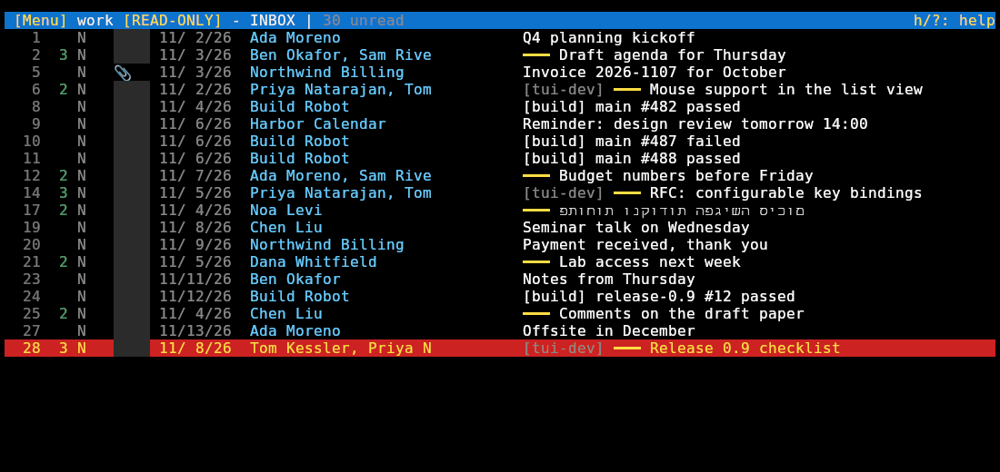

<p align="center">
  
</p>

# feral

[](https://github.com/sarielhp/feral/actions/workflows/ci.yml)
[](https://go.dev/)
[](https://opensource.org/licenses/MIT)

A terminal mail client for Linux: a full-screen TUI and a scriptable command
line, talking directly to Gmail, Microsoft 365 / Outlook and Fastmail (JMAP),
and reading local mbox files. One binary; no `mbsync`, `msmtp` or `notmuch`
to keep in step.



<sub>Recorded with `tools/demo_gif` on a synthetic mailbox (`testdata/demo/`), under `--read-only`.</sub>

It is for people who read a lot of mail in a terminal and want the same
mailbox to answer both keys and scripts: browse and triage in the TUI, then
pipe, send, search and export from the shell.

- **Backends**: Gmail through its REST API (OAuth with your own Google Cloud
  client), Microsoft 365 / Outlook through Graph (device-code sign-in),
  Fastmail through JMAP (API token), and local mbox files.
- **TUI**: split preview, threads, a folder tree, an inbox across all accounts,
  list filters and fuzzy search, attachments, Hebrew and other right-to-left
  text, clickable links, the mouse, and keys you can move.
- **Command line**: scan, show, send (from stdin, raw RFC 822, or at a later
  time), reply, search, export to mbox, snooze, mute, unsubscribe.
- **Housekeeping**: bogofilter spam training, server-side rules, contacts with
  ranked completion, OpenPGP through your own `gpg`, and optional LLM summaries.
- **A local cache**: every message is downloaded once and kept, so reading,
  filtering and re-opening are local.

## Install

Releases are source-only; no prebuilt binaries are published. Building needs
Go 1.26.5 or newer.

```bash
go install github.com/sarielhp/feral@latest      # puts feral in $(go env GOPATH)/bin
```

or from source:

```bash
git clone https://github.com/sarielhp/feral.git
cd feral
make                                              # builds bin/feral
```

An Arch Linux `PKGBUILD` that builds from the tagged source is in
[contrib/aur/](contrib/aur/).

## First run

```bash
feral account setup          # guided setup: Fastmail, Gmail or Outlook
feral account list
feral tui
```

The guides walk through each provider's credentials:
[Fastmail](docs/setup/fastmail.md) (an API token),
[Gmail](docs/setup/gmail.md) (your own OAuth client, a one-time setup; feral
ships no shared Gmail credentials) and
[Outlook / Microsoft 365](docs/setup/outlook.md) (device-code sign-in).

A local mbox file can be an account too, created read-only:

```bash
feral account add mbox old-mail --path ~/mail/2019.mbox
feral mbox view archive.mbox          # or just look at one file, no account
```

The configuration lives in `~/.config/feral/config.json` (a `~/.config/mail_cli`
from before the rename is moved there on the first run that may write).
`feral account default <name>` picks the account a command uses when none is
named; `-A <name>` or `-N` (e.g. `-2`) picks one for a single command.

## The TUI

`feral tui` opens the default account's inbox; `feral tui %receipts` opens a
folder. Press <kbd>F1</kbd>, <kbd>h</kbd> or <kbd>?</kbd> on any screen for
the keys of that screen. The most used ones:

| Keys | In the message list |
|---|---|
| <kbd>j</kbd> / <kbd>k</kbd>, <kbd>Home</kbd> / <kbd>End</kbd> | move; first / last message |
| <kbd>Space</kbd> | split preview (<kbd>←</kbd> / <kbd>→</kbd> step through messages) |
| <kbd>Enter</kbd> or <kbd>e</kbd> | read the message (<kbd>Esc</kbd> back to the list) |
| <kbd>Tab</kbd> | unfold or fold a thread |
| <kbd>f</kbd> | folder tree; with two or more accounts it holds *All Inboxes* |
| <kbd>F3</kbd> / <kbd>F8</kbd> | switch account / recent folders |
| <kbd>/</kbd> | filter the list (`list:<id>` matches a mailing list) |
| <kbd>=</kbd> | show only the selected message's mailing list |
| <kbd>~</kbd> / <kbd>Ctrl+f</kbd> | fuzzy search all accounts / search the server |
| <kbd>c</kbd>, <kbd>r</kbd> / <kbd>g</kbd> / <kbd>G</kbd>, <kbd>b</kbd> | compose; reply / reply all / reply to the list; forward |
| <kbd>E</kbd>, <kbd>d</kbd>, <kbd>S</kbd> | archive, delete, mark as spam |
| <kbd>z</kbd> | undo the last move (archive, delete, spam, move; the last ten) |
| <kbd>H</kbd> | snooze: hide the message until a time |
| <kbd>M</kbd> / <kbd>X</kbd> | mute the thread / leave the mailing list |
| <kbd>t</kbd>, <kbd>;</kbd> | tag messages; act on the tagged ones |
| <kbd>v</kbd>, <kbd>w</kbd> | attachments and parts; open in the browser |
| <kbd>F4</kbd> | summarize with the configured LLM |
| <kbd>F9</kbd> | mouse on / off |
| <kbd>q</kbd>, <kbd>Ctrl+q</kbd> | quit |

A message from a list carries its tag (`[tui-dev]`) ahead of the subject. A
link in HTML mail is drawn over its own text and numbered (`Sign in[1]`), and
the references below the message name each target.

The list's and the message view's keys are named actions. `feral utils keys`
prints them all with their defaults as a `keys.json`; put the ones you want to
change in `~/.config/feral/keys.json` (for example
`{"format": 1, "list": {"archive": "A"}}`). A broken file stops the TUI and
names the line.

## The command line

Every command has `-h` for a short listing, `-H` for the details, and
`feral -E <command>` for examples. A folder is written `%name`; `%` alone is the
inbox, and `%account:folder` names another account's.

```bash
# Read
feral %                                   # list the default account's inbox
feral %work:receipts                      # one folder of the account "work"
feral msg show <id>                       # a message, with its attachments
feral msg last 20                         # the newest mail across all folders
feral search "from:billing has:attachment" -n 25   # a query on the server
feral search "taxes 2025" --all -o taxes.mbox     # export every match

# Write
feral write boss@example.com -s "Status"           # $EDITOR, then a review screen
feral msg send -s "Report" -a report.pdf user@example.com < notes.txt
feral msg send --raw < patch.eml                   # a complete RFC 822 message
feral msg send --at "tomorrow 8am" -s "Reminder" team@example.com < body.txt
feral msg reply <id>                               # -g all, -l the list, --headless --body "..."

# Triage
feral msg archive <id>...
feral msg snooze --until "+2h" <id>       # back in the inbox, unread, at that time
feral msg mute <id>                       # new messages in the thread skip the inbox
feral msg unsub <id>                      # leave the list; shows the plan and asks
feral spam mark <id>                      # move to Spam; bogofilter learns it

# Around it
feral watch                               # notify on new mail; sends what --at queued
feral contacts tui                        # manage contacts full screen
feral account signature work --edit       # a signature per account
feral link add mt -- -A work tui          # `mt` now runs `feral -A work tui`
feral utils completion install            # shell completion
```

`watch` is what sends mail queued with `--at` once it is due, and what brings
snoozed messages back. The TUI runs the same watcher while it is open, except
that it never sends queued mail. `feral msg outbox flush` and
`feral msg snooze --wake` do either by hand, or from cron.

The top-level commands: `scan`, `search`, `write`, `tui`, `watch`, `msg`,
`label`, `mbox`, `spam`, `rule`, `calendar`, `contacts`, `account`, `link`,
`config` and `utils`. `feral help` lists them with one line each.

## Safety

- **`--read-only`** blocks every change on the server and every local record of
  a change that did not happen: `msg block` and `spam mark` refuse, and so do
  snoozing, muting and queued sends (`--queue`, `--at`). The cache is still written: downloaded messages and
  read state are facts the server reported. An mbox account is created
  read-only.
- **`-D`, `--dry-run`** reports what a command would do instead of doing it.
  It implies `--read-only`, and on top of it writes no configuration and no
  local records: no cache clearing, no training, no `config.json`.
- Commands that delete permanently say so in their help (`spam empty`).
  `utils doctor` writes to the account to prove it can, and is refused under
  both flags.
- HTML mail opened in the browser loads nothing from the network and runs no
  scripts, so tracking pixels do not fire. Unsubscribe links are fetched only
  through a client that refuses local and private addresses, and plain web links
  are handed to the browser, never fetched.

## Documentation

- Setup: [Fastmail](docs/setup/fastmail.md), [Gmail](docs/setup/gmail.md),
  [Outlook](docs/setup/outlook.md)
- Every command: [docs/clihelp/](docs/clihelp/index.md), or `feral utils manpage`
- What changed: [docs/CHANGELOG.md](docs/CHANGELOG.md)
- How it is built: [docs/ARCHITECTURE.md](docs/ARCHITECTURE.md)

feral was called `mail_cli` until 0.7.77; old configuration and caches are
still found.

## License

[MIT](LICENSE).
